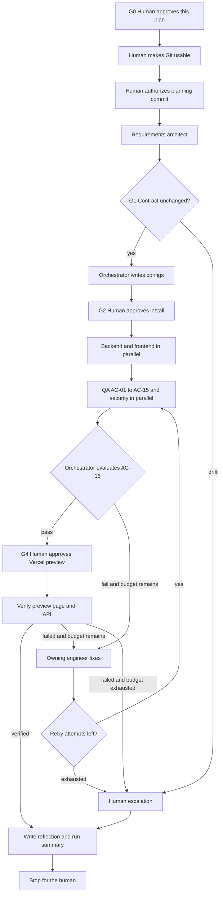

# Workflow

One page. This is the planned order. It is not a record of work already done.

QA verifies AC-01 through AC-15. The orchestrator evaluates AC-16 only after both the QA report and the security review exist. A retry uses at most two further attempts. When that budget is exhausted, the run escalates to the human. The reflection and run summary are written on that path, and also when preview verification fails or the run stops early.
